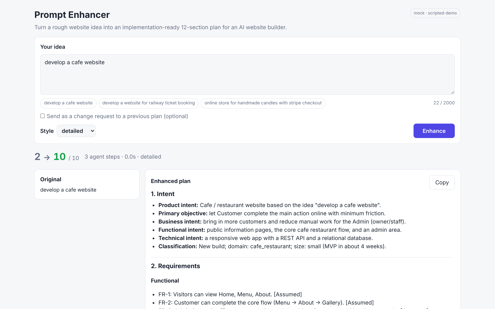
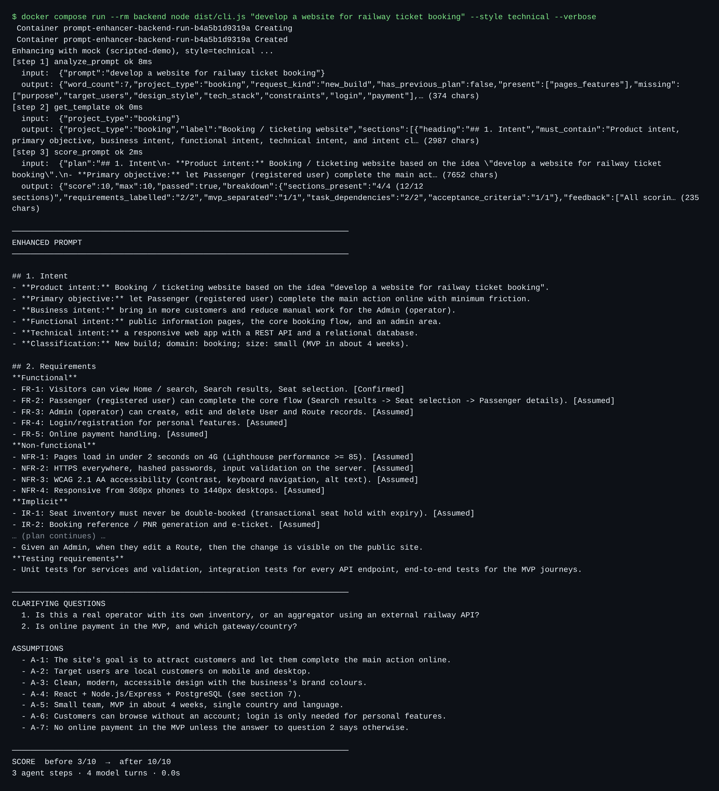
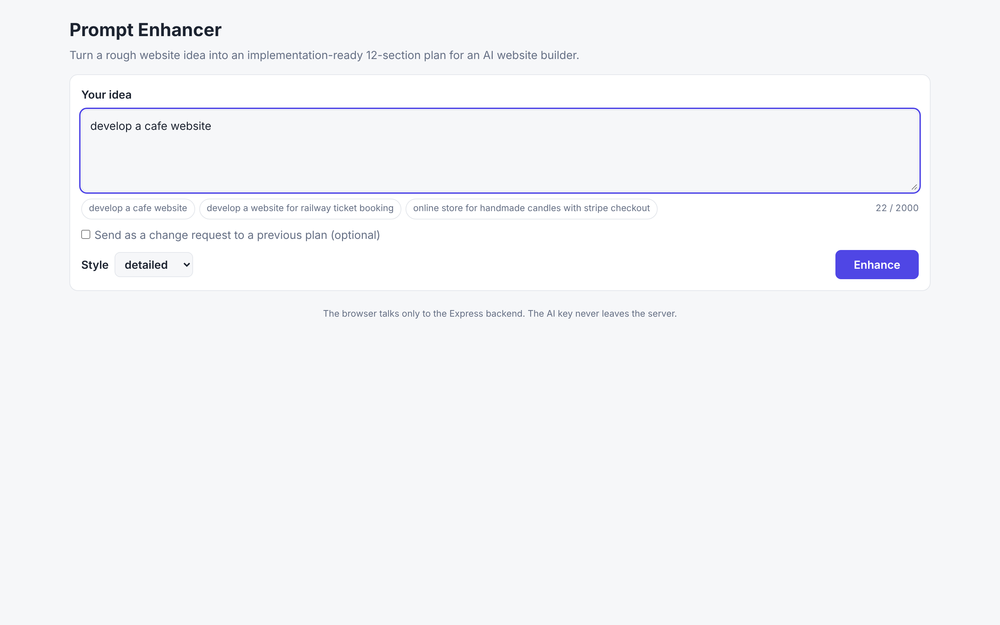
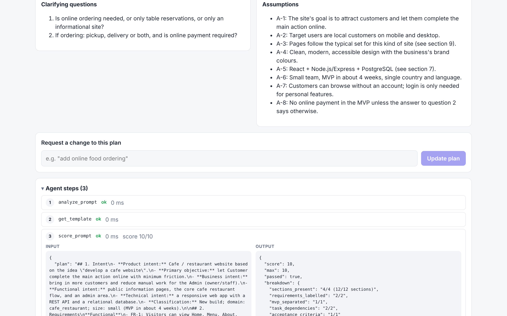
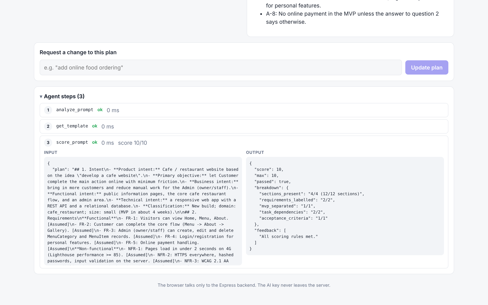

# Prompt Enhancer Agent

A small planner web app. You type a rough website idea such as *"develop a cafe website"*, and an AI agent turns it into an implementation-ready **12-section plan prompt** for an AI website builder (intent, requirements, ambiguities, scope, users, architecture, technology, database, UI/UX, tasks, risks, validation).

The work is done by a real tool-calling agent: the model decides which tool to call, the backend runs it and sends the result back, and only after scoring its own draft does the model return the final plan. The same agent runs behind a REST API, a React page and a terminal command, and everything runs in Docker.

| | |
|---|---|
| **Live frontend** | _add your Vercel/Netlify URL here after deploying (see [Deployment](#deployment))_ |
| **Live backend** | _add your Render URL here_ |



---

## Tech used

| Layer | Choice |
|---|---|
| Frontend | React 19 + Vite + TypeScript, `react-markdown` + `remark-gfm` |
| Backend | Node.js 22 + Express 5 + TypeScript, `zod` for tool argument validation |
| AI provider | **Google Gemini** (`gemini-2.5-flash`, native function calling) or **Groq** (OpenAI-compatible tool calling). A keyless `mock` provider exists for offline demos and tests |
| Containers | Docker multi-stage builds, nginx for the frontend, Docker Compose |
| Tests | Vitest + Supertest (39 tests: tools, agent loop safety rules, API status codes, provider error mapping) |

No AI SDKs are used: the two providers are called with `fetch`, which keeps timeouts and error mapping explicit.

## How it works

```
Browser ──► nginx (frontend container) ──/api──► Express (backend container) ──► Gemini / Groq
                                                     │
CLI (node dist/cli.js) ─────────────────────────────►┘   same runAgent() for both
```

### The agent loop (`backend/src/agent/agent.ts`)

1. Send the system prompt, the user's prompt and the 3 tool definitions to the model (native function calling, no text parsing).
2. If the model asks for a tool, the backend validates the arguments, runs the tool and sends the result back.
3. Repeat until the model gives a final answer or the step limit is hit.
4. Return the plan, questions, assumptions, before/after score and the full step log.

Expected path: `analyze_prompt` → `get_template` → (model writes the draft) → `score_prompt` → if score < 7, improve and `score_prompt` again → final answer.

### Tools (`backend/src/agent/tools.ts`)

| Tool | What it returns |
|---|---|
| `analyze_prompt(prompt)` | word count, project type (`cafe_restaurant`, `booking`, `ecommerce`, `portfolio`, `other`), `new_build` or `change_to_existing`, and which of purpose / target users / pages & features / design style / tech stack / constraints / login / payment are present or missing |
| `get_template(project_type)` | the 12-section template with what each section must contain, plus typical roles, entities (e.g. Booking, Seat, Payment), pages, implicit requirements and blocking-question hints |
| `score_prompt(plan)` | 0–10 from fixed rules: 12 sections present in order (4), requirements tagged Confirmed/Assumed (2), MVP separated (1), tasks list dependencies (2), acceptance criteria (1); plus concrete feedback |

### Loop safety rules

| Rule | Implementation |
|---|---|
| Max 5 steps | `AGENT_MAX_STEPS=5` tool calls. On the limit the best scored draft is returned with `"warning": "step limit reached"` |
| Unknown tool | Not executed; `{"error": "Unknown tool ... Available tools: ..."}` is sent back so the model can correct itself |
| Bad / missing / non-JSON arguments | Validated with zod; the error message goes back to the model |
| Tool throws | Caught, logged, sent back as an error result; the run continues |
| Order | Any tool before `analyze_prompt` gets an error telling the model to call it first. A final answer without `score_prompt` gets one nudge to score first |
| Provider fails after a draft exists | The best scored draft is returned with a warning instead of a failed request |
| Logging | Every step (tool, input, output, ok, duration) is logged and returned in `steps` |
| Secrets | Keys are sent in headers (never URLs), and every log line and error message goes through `redact()` |

The `after` score is recomputed by the backend on the plan it actually returns, so it cannot be inflated by the model. The `before` score rates the raw idea on how much of the `analyze_prompt` checklist it covers.

### System prompt

`backend/src/agent/systemPrompt.ts` was written for this agent. It sets the planner role, the mandatory tool order and 5-call budget, the 12 headings with what each must contain (generated from the same `sections.ts` the scorer uses), the planner rules (ask only blocking questions, label every requirement, small MVP, consistent names, preserve existing plan on changes), the quality bar (score ≥ 7), the style rules (`short`, `detailed`, `technical`) and the exact output format (`<plan>`, `<questions>`, `<assumptions>`, `<changes>` blocks).

---

## API

### `GET /api/health`
`{ "status": "ok" }`

### `POST /api/enhance`

```json
{ "prompt": "develop a cafe website", "style": "detailed", "previousPlan": null }
```

`style` is optional (`short`, `detailed`, `technical`, default `detailed`). When `previousPlan` is sent, `prompt` is treated as a change request and the agent updates that plan, keeping everything the change does not touch, and lists what changed.

Response:

```json
{
  "original": "develop a cafe website",
  "enhanced": "## 1. Intent ... ## 12. Validation ...",
  "questions": ["Is online ordering needed, or only table reservations?"],
  "assumptions": ["A-1: Single cafe location"],
  "changes": [],
  "score": { "before": 2, "after": 10 },
  "steps": [
    { "step": 1, "tool": "analyze_prompt", "input": {...}, "output": {...}, "ok": true, "durationMs": 3 },
    { "step": 2, "tool": "get_template",   "input": {...}, "output": {...}, "ok": true, "durationMs": 1 },
    { "step": 3, "tool": "score_prompt",   "input": {...}, "output": {...}, "ok": true, "durationMs": 2 }
  ],
  "warning": null,
  "meta": { "provider": "gemini", "model": "gemini-2.5-flash", "style": "detailed", "mode": "new", "modelTurns": 4, "durationMs": 21400 }
}
```

`changes` and `meta` are additions to the brief's shape; everything else matches it.

### Errors (always `{ "error": "..." }`)

| Situation | Status |
|---|---|
| Missing/empty prompt, wrong type, > 2000 chars, bad `style`, invalid JSON | 400 |
| AI key missing or invalid (message never contains the key) | 500 |
| Provider rate limit | 429 |
| Provider failure / unreachable | 502 |
| Provider slower than `AI_TIMEOUT_MS` (default 60 s) | 504 |

---

## Setup and run with Docker

Only Docker is needed.

```bash
git clone <this repo> prompt-enhancer && cd prompt-enhancer
cp .env.example .env          # then put your free Gemini key in GEMINI_API_KEY
docker compose up --build
```

- Frontend: <http://localhost:8080>
- Backend: <http://localhost:4000/api/health>

`docker compose down` stops and removes everything.

Get a free key at <https://aistudio.google.com/apikey> (Gemini) or <https://console.groq.com/keys> (Groq, then set `LLM_PROVIDER=groq`). To try the app with no key at all, set `LLM_PROVIDER=mock`: a scripted stand-in drives the same loop and tools, but the plans are generic templates, not AI output.

### What the Docker setup does

- `backend/Dockerfile`: multi-stage (TypeScript build → `node:22-alpine` runtime with production deps only), runs as the non-root `node` user, `HEALTHCHECK` on `/api/health`.
- `frontend/Dockerfile`: multi-stage (Vite build with Node → `nginx:1.27-alpine` serving the static files). nginx proxies `/api/` to the backend, so the browser stays same-origin and no CORS setup is needed in Docker.
- `docker-compose.yml`: images are named `prompt-enhancer-backend:1.0` and `prompt-enhancer-frontend:1.0`; the frontend waits for `service_healthy` on the backend; the key reaches the backend only through `env_file: .env` at runtime.
- `.env` is in `.gitignore` and both `.dockerignore` files, is never copied into an image and is never a build argument.

## CLI

The CLI (`backend/src/cli.ts`) calls the same `validateEnhanceInput` and `runAgent` as the API.

```bash
# inside Docker
docker compose run --rm backend node dist/cli.js "develop a cafe website"
docker compose run --rm backend node dist/cli.js "develop a website for railway ticket booking" --style technical --verbose

# locally (from backend/ after npm ci && npm run build)
node dist/cli.js "develop a cafe website"
node dist/cli.js "add online food ordering" --previous plan.md   # change request on a saved plan
node dist/cli.js "develop a cafe website" --out plan.md --json
```

| Flag | Meaning |
|---|---|
| `-s, --style` | `short`, `detailed` (default) or `technical` |
| `-v, --verbose` | print every agent step (tool, input, output) as it happens |
| `-p, --previous <file>` | previous plan; the prompt becomes a change request |
| `-o, --out <file>` | also save the plan to a file |
| `--json` | print the full API-shaped JSON |
| `--debug` | show backend log lines on stderr |

It prints the plan, the questions, the assumptions and `SCORE before X/10 → after Y/10`, and exits with code 1 and a clear message on errors.



---

## Example prompts and results

The full outputs are in [`examples/`](examples) (`.txt` = CLI output, `.json` = API response).

| # | Prompt | Style | Detected type | Score | Steps |
|---|---|---|---|---|---|
| 1 | `develop a cafe website` | detailed | `cafe_restaurant` | 2 → 10 | analyze_prompt → get_template → score_prompt |
| 2 | `develop a website for railway ticket booking` | technical | `booking` | 3 → 10 | analyze_prompt → get_template → score_prompt |
| 3 | `online store for handmade candles with stripe checkout` | short | `ecommerce` | 4 → 10 | analyze_prompt → get_template → score_prompt |

> **Note:** the committed example files were generated with `LLM_PROVIDER=mock` while building the project, so their plan text is template-based. Run `sh scripts/generate-examples.sh` with your Gemini key in `.env` to replace them with real AI output (the step log, scores and format stay the same).

Example 1, clarifying questions returned:
1. Is online ordering needed, or only table reservations, or only an informational site?
2. If ordering: pickup, delivery or both, and is online payment required?

Example 2 template entities used: User, Route, Station, Train, Schedule, Seat, Booking, Passenger, Payment, Ticket.

## Screenshots

| | |
|---|---|
|  |  |
|  |  |

---

## Deployment

### Backend on Render
1. New → **Blueprint**, pick this repo (uses [`render.yaml`](render.yaml)), or New → Web Service → Docker with root directory `backend`.
2. Set `GEMINI_API_KEY` in the Render dashboard (never in git) and `CORS_ORIGIN` to your frontend URL.
3. Health check path: `/api/health`.

### Frontend on Vercel (or Netlify)
1. Import the repo, set the **root directory** to `frontend` (framework: Vite).
2. Add the environment variable `VITE_API_URL=https://<your-render-service>.onrender.com`.
3. Deploy. `frontend/vercel.json` and `frontend/netlify.toml` handle SPA routing.

Put both URLs at the top of this README. Note that Render's free tier sleeps when idle, so the first request can take ~30 s.

## Local development without Docker

```bash
cp .env.example .env                       # add your key
cd backend && npm ci && npm run dev        # http://localhost:4000
cd frontend && npm ci && npm run dev       # http://localhost:5173 (proxies /api to :4000)
cd backend && npm test                     # 39 tests, no key needed
```

## Repository layout

```
prompt-enhancer/
├── backend/
│   ├── src/
│   │   ├── server.ts            # starts Express
│   │   ├── app.ts               # middleware, routes, central error handler
│   │   ├── cli.ts               # terminal command (reuses the agent)
│   │   ├── routes/enhance.ts    # POST /api/enhance
│   │   ├── routes/validate.ts   # request validation (API + CLI)
│   │   ├── agent/agent.ts       # the tool-calling loop and final-answer parsing
│   │   ├── agent/tools.ts       # analyze_prompt, get_template, score_prompt
│   │   ├── agent/systemPrompt.ts
│   │   ├── agent/sections.ts    # the 12 sections (shared by prompt, template, scorer)
│   │   ├── llm/                 # client.ts factory, gemini.ts, groq.ts, mock.ts, http.ts
│   │   └── lib/                 # config, errors + redact, logger
│   ├── test/                    # vitest: tools, agent loop, API
│   ├── Dockerfile, .dockerignore, package.json
├── frontend/
│   ├── src/                     # App.tsx, api.ts, styles.css
│   ├── nginx.conf.template, Dockerfile, .dockerignore, vercel.json, netlify.toml
├── examples/                    # 3 example runs
├── docs/screenshots/
├── scripts/generate-examples.sh
├── docker-compose.yml, render.yaml, .env.example, .gitignore
└── README.md
```

## Security notes

- The key lives only in `.env` (git-ignored, docker-ignored) or in the hosting dashboard.
- The frontend never talks to the AI provider and never holds a key; its only config is the public backend URL.
- Keys are sent in request headers, and every log line and error message is passed through `redact()`; a test checks that an invalid-key error response never contains the key.
